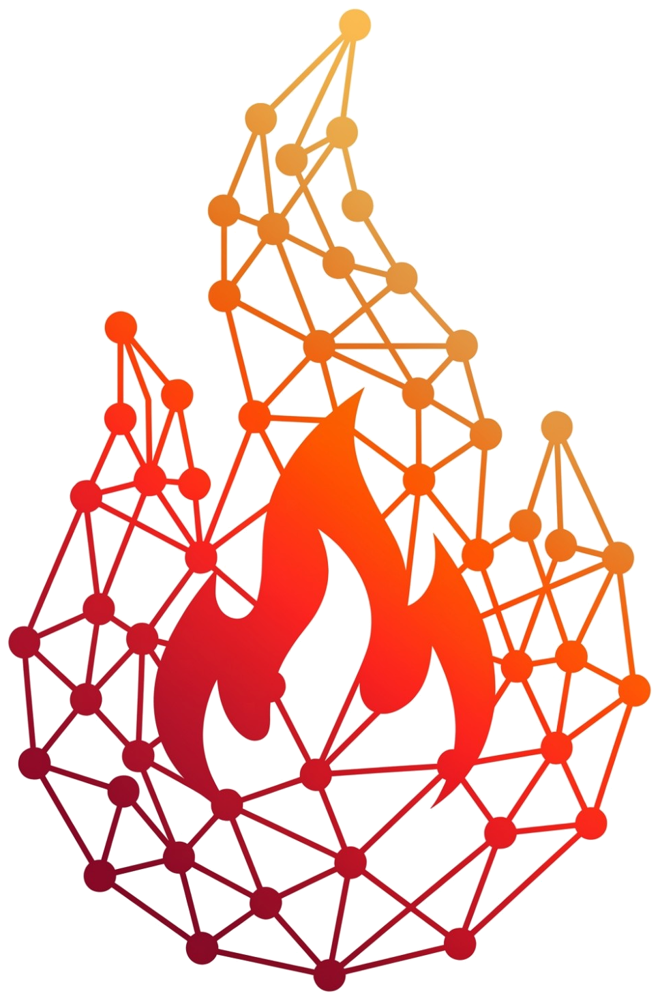

<!-- Badges -->

[](https://hub.docker.com/r/pavlopouloslab/flame)
[](https://github.com/PavlopoulosLab/Flame/blob/main/LICENSE)

<p align="center"></p>

# Flame 3.0: Functional Analysis and Integration made easy

Flame runs functional and literature enrichment on one or many gene lists with eight established tools
(g:Profiler, STRING, Enrichr, WebGestalt, PANTHER, GeneCodis, Reactome, clusterProfiler) plus your own GMT gene sets,
combines their results, and lets you explore them with interactive plots and networks. It also starts from
variants and GWAS results. It is free and open to everyone.

The workspace has four tabs: **Input** (every way to add a gene list), **Enrichment** (runs and comparisons),
**Regulators & drugs** (what controls a list, protein network) and **Gene tools** (inspect and transform a list).

This image bundles the web app and the versioned REST API behind a single port — no separate database or
reverse proxy needed to get started.

## Features

* **Inputs**: paste/upload IDs (19 formats) or ranked lists with scores; select genes on a volcano plot (draggable
  thresholds), a 2D plot (UMAP/t-SNE/PCA) or an expression matrix (co-expression clusters, gene map, two-group test,
  pathway activity per sample); map SNPs to genes; find genes in text; microRNAs → miRDB targets; UpSet set
  operations (intersection, union, XOR and more, with selectable bars); and **fetch gene lists** from a disease
  (choose among Open Targets, DisGeNET, OMIM, Orphanet, ClinVar, Jensen DISEASES and GWAS Catalog; merge several
  results), PubMed articles, GEO datasets (RummaGEO) or ClinVar (by gene, condition, rsID or accession); or start
  from variants or GWAS results and save the affected genes. Every selection is listed before it is saved, and
  saving returns to the Input tab.
* **Lists**: always in view; click a list to see its contents with gene annotations (symbol, Ensembl ID,
  description), edit it, or tick several lists to compare them (UpSet) or run the same enrichment on all of them.
* **Gene tools**: annotate a list (current symbol, name, gene type, chromosome location, Ensembl and Entrez IDs;
  Excel/TSV export), check and clean it (unrecognised IDs, outdated symbols, duplicates), filter it (by gene type or
  chromosome, drop placeholder names), convert IDs and find orthologs. Annotation uses MyGene.info.
* **Enrichment**: eight tools across 14,000+ organisms; over-representation (ORA) and, with clusterProfiler/fgsea on
  MSigDB, gene set enrichment (GSEA) of ranked lists; literature enrichment (PubMed, GeneSigDB, Rummagene); cell types;
  your own pathway sets (GMT, uploaded in the New run panel; ORA only), custom backgrounds (one of your lists, chosen
  per tool), per-tool settings. Up to 20 runs per workspace can be queued or running at once.
* **Beyond term lists**: transcription factors (ChEA3) and kinases (KEA3), drug and CRISPR signatures that mimic or
  reverse a response (LINCS L1000), the STRING protein network with module detection and per-module enrichment,
  and robustness checks (bootstrap stability, random-list control, FDR thresholds).
* **Results**: all annotation sources together or one tab per source (GO:BP, GO:CC, KEGG…); table, dot plot, bar chart, scatter, heatmaps, networks, Sankey, chord, hive and Circos (edge bundling)
  views; functional **themes** and word clouds; a selection panel with ranked, clickable genes, GeneCards and genome
  browser links, and KEGG maps with the user's genes coloured; undo/redo; image export of every figure (PNG, SVG, PDF, JPEG, WebP) and CSV/HTML exports.
* **Comparison**: compare tools, lists or strategies with Fisher's combined p-value, a **consensus rank** (Robust Rank
  Aggregation) and a rank chart, a table of which run found what, agreement statistics (Jaccard, rank correlation,
  McNemar / Cochran's Q, concordance at the top, MDS), UpSet, chord, Circos, bubble plot and heatmap.
* **Variants and GWAS** (an input option): rsIDs, VCF lines, HGVS or GWAS summary statistics annotated with Ensembl
  VEP (consequence, impact, gnomAD frequency, ClinVar) and trait associations; Manhattan and genome Circos plots;
  genes → a list → enrichment.
* **Networks**: STRING networks as multi-edge evidence networks; open networks, comparisons and variant reports in
  Arena3D (3D multilayer networks) or NORMA, or directly in STRING.
* **Display**: light/dark themes; every visualization has its own palette (Flame, colour-blind safe, vivid, pastel,
  grayscale), offered only where there is a chart or network; box and lasso selection on charts; progress bars on
  slow steps; works at phone width.
* **Workspaces**: private bookmarkable links, session save/load (lists, runs, analyses), automatic expiry.
* **Programmatic access**: versioned REST API (`/api/v1`) with an OpenAPI 3 document and Swagger UI, and a Python
  command-line client.

## Quick start

```bash
docker pull pavlopouloslab/flame:3.0
docker run -d --name flame -p 8000:8000 -v flame-data:/data pavlopouloslab/flame:3.0
```

Or with Compose:

```yaml
services:
  flame:
    image: pavlopouloslab/flame:3.0
    ports:
      - "8000:8000"
    volumes:
      - flame-data:/data
    restart: unless-stopped
volumes:
  flame-data:
```

Then open http://localhost:8000. The same server provides the web app and the versioned REST API (`/api/v1/...`;
interactive reference at `/__docs__/`, OpenAPI 3 specification at `/openapi.json`). Workspaces are stored in the
`flame-data` volume (`/data/flame.sqlite`), so they survive container upgrades. Pin a version tag (e.g. `3.0`,
rather than `latest`) for reproducible deployments.

This image is built for the main path (`FLAME_BASE_PATH=/`). For a subpath deployment, another R release, or any
other build-from-source option, see the [GitHub repository](https://github.com/PavlopoulosLab/Flame).

## Configuration (environment variables)

Set any of these with `-e VAR=value` on `docker run`, or under `environment:` in Compose.

| Variable | Default | Purpose |
|---|---|---|
| `FLAME_PORT`, `FLAME_HOST` | `8000`, `0.0.0.0` | Listening address inside the container |
| `FLAME_DB` | `/data/flame.sqlite` | Workspace database |
| `FLAME_WORKERS` | `4` | Background enrichment workers |
| `FLAME_MAX_ACTIVE_JOBS` | `20` | Enrichment runs and analyses a workspace may have queued or running at once; `FLAME_WORKERS` of them run at the same time, the rest wait their turn |
| `FLAME_RETENTION_DAYS` | `30` | Delete workspaces after this many days without use |
| `FLAME_MAX_LISTS` | `10` | Lists per workspace (0 = unlimited) |
| `FLAME_PUBLIC_URL` | – | Public base URL (used in links and emails) |
| `FLAME_SMTP_URL`, `FLAME_SMTP_FROM` | – | Optional "results ready" emails |
| `FLAME_WORKSPACE_LIMIT` | `30` | New workspaces per hour per client address (0 = no limit) |
| `FLAME_RATE_LIMIT` | `600` | API requests per minute per client address (0 = no limit, e.g. for local testing) |
| `FLAME_NCBI_API_KEY` | – | NCBI E-utilities key for the PubMed and ClinVar inputs (10 instead of 3 requests per second; recommended for public servers) |

## Deployment

Run the container behind an HTTPS reverse proxy (nginx, Apache, Caddy, …) on port 443 and forward to `FLAME_PORT`
(`8000` by default). The server sets security headers and a strict Content-Security-Policy; the web app loads no
third-party scripts, fonts or cookies.

## Learn more

Source code, the full configuration reference, building from source, and tests: the
[GitHub repository](https://github.com/PavlopoulosLab/Flame).

## Publications

If you use Flame, please cite:

* Karatzas E., Baltoumas F.A., Aplakidou E., Kontou P.I., Stathopoulos P., Stefanis L., Bagos P.G., Pavlopoulos G.A. (2023)
  **Flame (v2.0): advanced integration and interpretation of functional enrichment results from multiple sources.**
  *Bioinformatics* 39(8):btad490. doi: [10.1093/bioinformatics/btad490](https://doi.org/10.1093/bioinformatics/btad490)
* Thanati F., Karatzas E., Baltoumas F.A., Stravopodis D.J., Eliopoulos A.G., Pavlopoulos G.A. (2021)
  **FLAME: a web tool for functional and literature enrichment analysis of multiple gene lists.**
  *Biology* 10(7):665. doi: [10.3390/biology10070665](https://doi.org/10.3390/biology10070665)

## License

This project is licensed under the **GNU General Public License v3.0 (GPL-3)** – see the
[LICENSE](https://github.com/PavlopoulosLab/Flame/blob/main/LICENSE) file for details.
